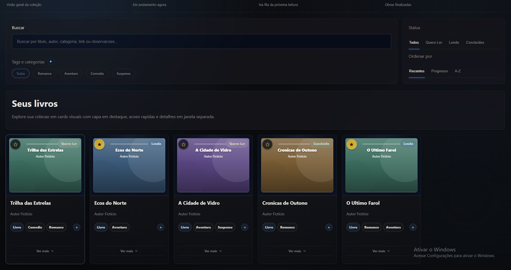
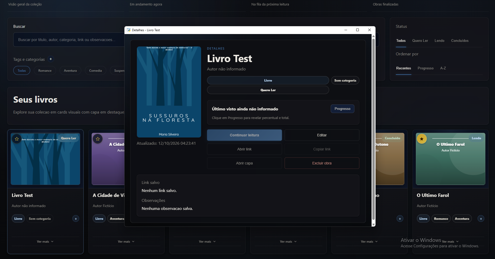
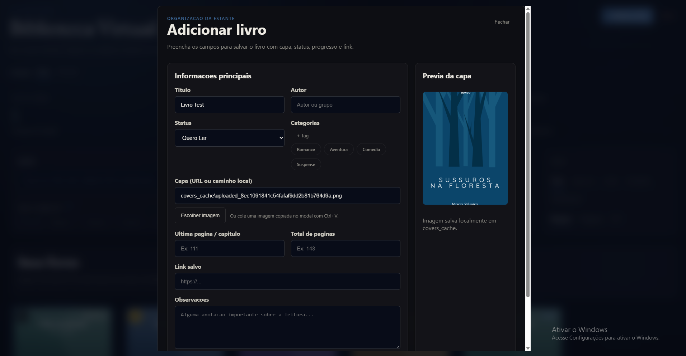
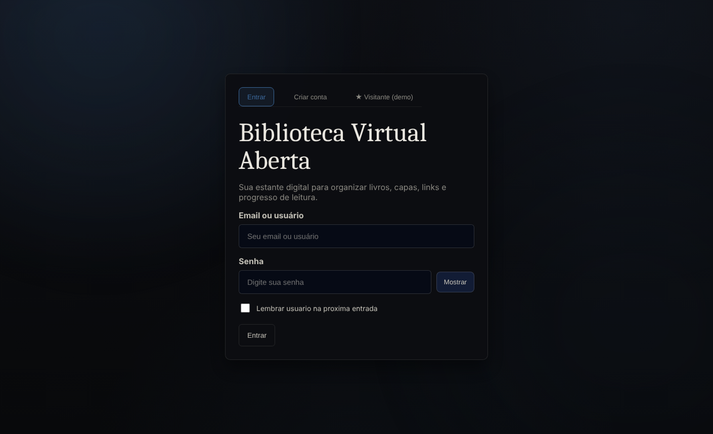

# Biblioteca Virtual Aberta

Uma biblioteca pessoal digital para organizar livros: capas, categorias, progresso de leitura, status e links de leitura — tudo local, num app desktop leve para Windows.

> Projeto de demonstração para portfólio. Roda totalmente local, sem servidor externo.

## Capturas de tela

**Painel da biblioteca** — capas coloridas geradas automaticamente, tags, status e favoritos:



**Janela de detalhes** — capa, progresso de leitura, link salvo e ações rápidas:



**Adicionar livro** — upload ou colagem de capa, categorias, progresso e observações:



**Tela de entrada** — login, cadastro e acesso rápido à conta de demonstração:



## Funcionalidades

- Cadastro de livros com capa (upload de arquivo, colar imagem, ou URL/caminho local)
- Múltiplas categorias por livro, com criação rápida de novas tags
- Acompanhamento de progresso de leitura (página atual / total)
- Status: Quero Ler, Lendo, Concluído
- Favoritos
- Busca por título, autor, categoria, link ou observações
- Ordenação por recentes, progresso ou A-Z
- Interface escura, com animações e feedback visual em cada interação

## Requisitos

- Windows 10 ou 11 (o app usa o WebView2, componente nativo do Windows)
- [Python 3.10+](https://www.python.org/downloads/) instalado e no PATH

## Instalação

1. Baixe ou clone este repositório
2. Abra um terminal na pasta do projeto
3. Instale as dependências:
   ```
   pip install -r requirements.txt
   ```
   (ou rode os arquivos `install_pillow.bat` e `install_webview.bat` incluídos)

## Como rodar

Dê duplo clique em `app.pyw`, ou pelo terminal:
```
python app.pyw
```

Esta versão já vem com uma **conta de demonstração** pré-cadastrada, com alguns livros fictícios (títulos e autores inventados só para exemplo; livros sem capa ganham uma capa colorida gerada automaticamente), pra você já ver o app funcionando de cara:

- **Usuário:** `Visitante` (ou o e-mail `demo@bibliotecavirtual.app`)
- **Senha:** `demo1234`

Você também pode criar sua própria conta pela tela de **Cadastrar-se** a qualquer momento (senha com no mínimo 8 caracteres) — os dados da conta demo não interferem em nada.

> A conta demo tem senha pública de propósito, só para facilitar o teste. Se você for usar o app de verdade, crie a sua conta.

## Estrutura do projeto

```
app.pyw            → lógica principal, banco de dados (SQLite), fallback desktop
web_runtime.py      → servidor local que conecta a interface web ao backend Python
webui/              → interface (HTML/CSS/JS)
covers_cache/        → cache local de capas baixadas (gerado em uso, não versionado)
screenshots/    → imagens usadas neste README
```

## Notas técnicas

- O app roda 100% localmente — nenhum dado é enviado para a internet, exceto o download opcional de capas quando você usa uma URL de imagem.
- O servidor local escuta apenas em `127.0.0.1`, numa porta aleatória — não é acessível de outros dispositivos na rede.
- Senhas são armazenadas com hash PBKDF2-SHA256 (200.000 iterações) e salt individual — nunca em texto puro.
- O modo alternativo em Tkinter (usado apenas se o WebView2/pywebview não estiver disponível) roda com um fundo simples, sem a imagem de fundo animada — mantém o app leve para clonar.
- Os livros de exemplo não têm imagem: as capas coloridas são desenhadas pela própria interface (título + autor), então não há nenhuma imagem de terceiros neste repositório.

## Segurança

Este é um app local de demonstração, e foi revisado com isso em mente:

- Servidor HTTP preso a `127.0.0.1`, porta aleatória, sem debug.
- Todas as consultas SQL são parametrizadas, e cada usuário só acessa os próprios livros.
- Saída HTML escapada na interface; capas aceitam apenas imagens raster (png, jpg, gif, webp, bmp), com limite de tamanho — SVG é recusado de propósito.
- Caminhos de capas são guardados relativos à pasta do app (não expõem o nome de usuário do Windows).
- Limite de tamanho nas requisições e verificação de `Origin` nas operações que alteram dados.
- Senha mínima de 8 caracteres e bloqueio temporário (60 s) após 5 tentativas de login erradas.

Limitações conhecidas (aceitas para um app de desktop de uso pessoal): há uma única sessão por execução do app, e outro programa rodando no mesmo computador que descubra a porta local poderia chamar a API enquanto você está logado. Não use este projeto como serviço exposto na internet.

### Para quem vai testar o app

- O app **não envia nada para a internet**. A única conexão externa possível é baixar uma capa quando você mesmo cola o endereço de uma imagem.
- Tudo fica dentro da pasta do projeto: `biblioteca.db` (suas contas e livros) e `covers_cache/` (capas). Para "desinstalar", é só apagar a pasta. O app também lembra, no armazenamento do próprio navegador embutido (WebView2), o *nome de login* se você marcar "Lembrar usuário" — nunca a senha.
- Não há telemetria, cookies de terceiros, fontes ou scripts externos.
- Os links de leitura só abrem endereços `http://` ou `https://`; qualquer outro tipo (`javascript:`, `file:`, `data:`) é recusado.
- Dependências verificadas com `pip-audit` (sem vulnerabilidades conhecidas) e o código com `bandit` (sem achados de risco real).
- Se você for registrar uma conta de verdade para testar, use uma senha que não use em outros lugares — o app é uma demonstração.

## Licença

MIT — veja o arquivo `LICENSE`.
